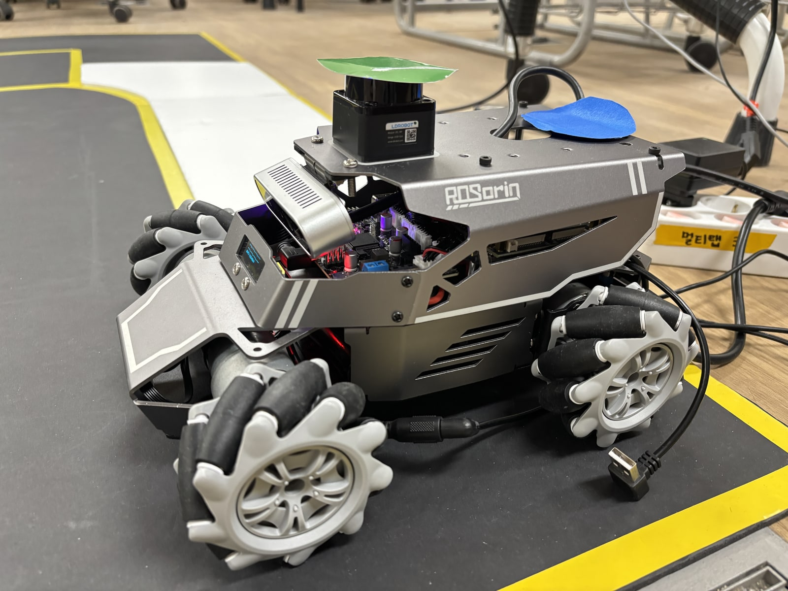
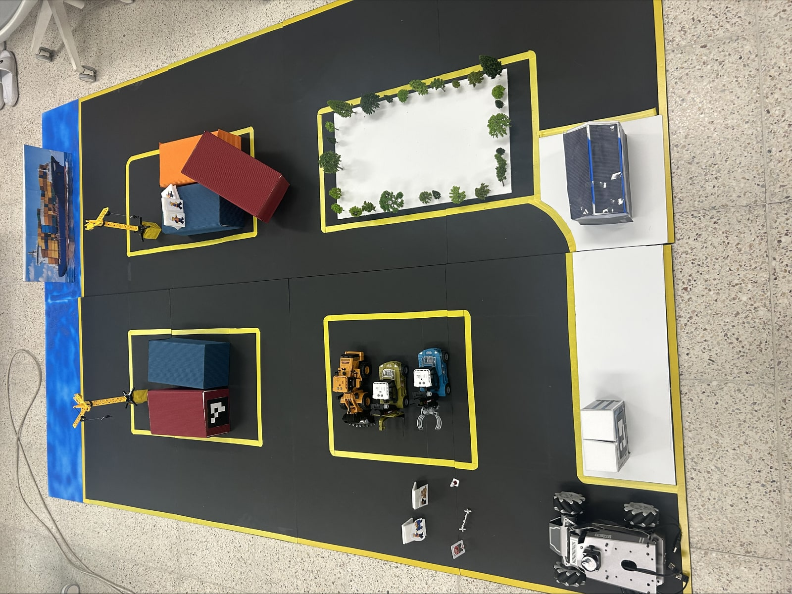

# NAVISIGHT

**작업자 횡단에는 대기하고, 막힌 경로는 우회하는 항만 AGV**

## 01. Overview

YOLO·Depth는 작업자와 장애물 등의 위험 후보를 감지하지만, 객체 검출 결과만으로 일시적인 횡단과 장기적인 경로 점유를 구분하기는 어렵습니다.

NAVISIGHT는 위험 후보를 감지하면 AGV를 우선 정지시키고, 필요한 상황에서 VLM이 연속 프레임의 움직임과 주변 맥락을 해석합니다. 안전 감독 모듈은 판단 결과를 검증하고 ROS 2 기반 주행·경로 계획 시스템과 연계하여 대기·재출발 또는 Dijkstra 기반 경로 재탐색을 수행합니다.

## 02. Demo / Physical System

  
  

<!-- DEMO_VIDEO: 사용자가 업로드한 실제 시연 영상 URL을 여기에 삽입 -->

ROSMASTER M1 · Jetson Orin NX 16 GB · Ubuntu 22.04 · ROS 2 Humble

[실기체 시연 시나리오](demos/README.md)

## 03. What We Built

| 상황 | 구현한 대응 |
| --- | --- |
| 작업자 횡단 | 선제 정지 → VLM 판단 → 대기 → 통로 해소 후 재출발 |
| 작업 구역·경로상 장애물 | 선제 정지 → 점유 판단 → 간선 차단 → Dijkstra 재탐색 |
| 경로 밖 장애물 | 장애물 위치와 남은 경로를 대조해 기존 경로 유지 |
| 불확실한 판단·오류 | 정지 유지, 필요한 경우 운영자 확인 |
| 누적 위치 오차 | 외부 카메라 BEV 관측과 오도메트리로 정차 지점 보정 |
| 운영자 관제 | 임무 시작·주행 상태 확인·승인·정지 연동 |

실기체 주행 기록과 승인·오류 처리의 ROS 연동 검증은 [검증 범위](docs/results_and_metrics.md#검증-범위)에 구분했습니다.

## 04. How It Works / Architecture

**위험 감지 → 안전정지 → 프레임 선택 → Bedrock VLM 판단 → Supervisor 검증 → 대기·재출발 또는 경로 재탐색**

VLM에는 최근 영상에서 시간순으로 선택한 최대 4장의 프레임을 전달합니다. Supervisor가 응답과 이벤트 시각을 확인하고, 경로 계획기가 차단 간선을 반영해 새 경로를 만듭니다. 최종 속도 명령은 웨이포인트 제어기가 생성합니다. 외부 카메라는 주행 위치 보정을, 웹 관제는 임무·상태·운영자 명령을 연결합니다.

[구조도 크게 보기](assets/system_architecture.svg) · [데이터 흐름과 ROS 2 토픽](docs/architecture.md)

## 05. Core Implementation

`src/`는 원본 핵심 로직을 일반화한 공개용 실행 예제입니다. 실기체 전체 구동 환경과 분리해 알고리즘과 모듈 입출력을 확인할 수 있도록 구성했습니다.

| 핵심 코드 | 입력 → 결과 |
| --- | --- |
| [ROS 2 통신](src/ros/topic_bridge.py) | 상태 토픽 → 이벤트 수·주행 단계 등의 요약 토픽 |
| [Dijkstra 경로 계획](src/navigation/graph_planner.py) | 지도·차단 간선 → 경유 노드 경로 |
| [주행 상태 관리](src/navigation/waypoint_controller.py) | 계획 경로·도착 피드백·정지 상태 → 주행 단계 |
| [BEV·오도메트리 보정](src/navigation/bev_localization.py) | 호모그래피·관측 자세 → 지도 좌표·제한 보정량 |
| [이벤트 트리거](src/perception/hazard_pipeline.py) | 연속 감지·시간순 프레임 경로 → 정지 권고 이벤트 |
| [AWS Bedrock 호출](src/vlm/bedrock_example.py) | 이미지 1~4장 → Converse 요청·장면 설명 텍스트 |
| [출력 스키마 검증](src/vlm/schemas.py) | 응답 객체 → 필드·열거값·신뢰도 검증 결과 |
| [안전 감독](src/vlm/safety_supervisor.py) | 이벤트·응답·승인 ID → 정지 권고를 포함한 `Advisory` |

[모듈 구성·로컬 실행·테스트](docs/development.md) · [Bedrock API 상세](docs/bedrock_api.md)

## 06. Results & Research

주행 기록은 **축소 항만 테스트베드**에서 측정했습니다.

| 평가 | 기록 |
| --- | --- |
| 통합 주행 · 2026-10-09 | 2회 완주: 155초 / 151초, 수동 개입 0회 VLM 호출 총 17회, 평균 응답 약 5.6초 |
| 별도 경로 비교 · 2026-09-27 | 감지 즉시 우회(T=0) → VLM 기반 대응 거리 10.15 m → 8.45 m, 시간 225초 → 227초 |
| 대회 이후 모델 평가 · 2026-10 | 저장된 40개 장면·장면별 4프레임 Bedrock 235B와 Jetson 8B·4B·2B 비교 |

경로 비교에서 VLM 방식의 이동 거리는 1.70 m 짧았고, 전체 소요시간은 2초 길었습니다. 후속 연구의 YOLO+Rule 임계시간 분석은 가정한 횡단 지속시간 분포로 계산했습니다.

[실주행 결과·지표 정의](docs/results_and_metrics.md) · [후속 모델·프롬프트·시간 규칙 연구](research/README.md)

## 07. Team

**마크리들 · NAVISIGHT**

| 이름 | GitHub |
| --- | --- |
| 김서영 | [@ksy0114](https://github.com/ksy0114) |
| 김범열 | [@Kim-Beom-Yeol](https://github.com/Kim-Beom-Yeol) |
| 강대현 | [@Kdahyn](https://github.com/Kdahyn) |
| 조현아 | [@hannah537079](https://github.com/hannah537079) |

관련 논문: 「항만 AGV의 비정형 작업 상황 대응을 위한 VLM 기반 상황 인식 및 경로 재탐색 연구」
