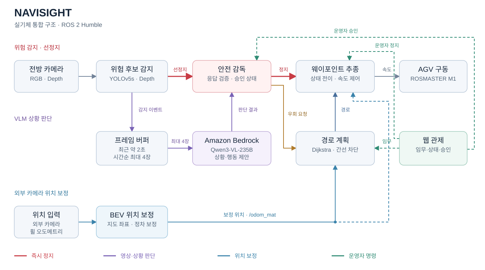
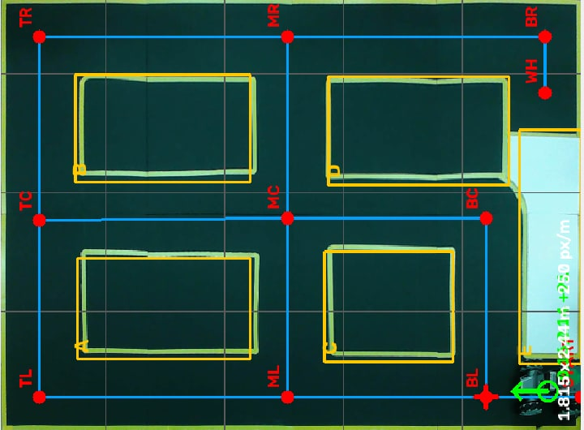

# 시스템 구조

## 모듈과 실행 위치

| 모듈 | 실행 위치 | 입력 | 처리 및 출력 |
| --- | --- | --- | --- |
| 전방 인지 | Jetson | RGB·Depth | YOLOv5s 사람 검출, Depth 장애물 후보, 작업 구역 단서 |
| VLM 브리지 | Jetson | 감지 이벤트·프레임 버퍼 | 최근 약 2초에서 최대 4프레임 선택, 비동기 VLM 요청 |
| VLM 상황 판단 | Amazon Bedrock | 시간순 이미지·장면 문맥 | 점유 유형·시간 변화·위험도·행동 제안 |
| 안전 감독 | Jetson | 위험 트리거·VLM 응답·운영자 승인 | 선정지, 응답 검증, 대기·재출발·우회 연계 |
| 경로 계획 | Jetson | 임무·현재 위치·우회 요청 | 간선 차단, Dijkstra 재탐색, 남은 경유지 연결 |
| 웨이포인트 추종 | Jetson | 경로·보정 위치·정지 상태 | 주행 단계 관리와 속도 명령 |
| 위치 보정 | 노트북·Jetson | 전·후방 표식·오도메트리 | 노트북의 BEV 관측 → Jetson의 UDP 수신·오프셋 보정 |
| 웹 관제 | Jetson·운영자 노트북 | 경로·위치·카메라·이벤트 | 상태 표시, 임무 시작, 운영자 정지·승인 |

## 상황 판단에서 주행까지

1. YOLO·Depth 인지가 위험 후보를 감지하고 안전 감독 모듈에 트리거를 전달합니다.
2. 안전 감독 모듈은 정지 상태를 설정합니다. VLM 브리지는 최근 프레임을 시간순으로 최대 4장 선택해 비동기로 요청합니다. 통로 해소 재확인에는 더 짧은 관측 구간을 사용합니다.
3. VLM은 객체의 이동과 주변 맥락을 해석해 구조화된 결과를 반환합니다.
4. 안전 감독 모듈은 응답과 이벤트 시각을 확인하고 대기, 재출발 또는 우회 요청으로 연결합니다.
5. 우회가 필요하면 경로 계획기가 장애물과 남은 경로를 대조해 영향을 받는 간선을 차단합니다.
6. 갱신한 경로를 웨이포인트 제어기로 전달하고, 재탐색 결과에 따라 주행을 이어갑니다.

| 장면 | 행동 | 후속 처리 |
| --- | --- | --- |
| 작업자 횡단 | `STOP_WAIT` | 정지 유지·후속 프레임 확인 |
| 통로 해소 | `KEEP` | 안전 감독을 거쳐 기존 경로 재개 |
| 작업 구역·경로상 장애물 | `REROUTE_REQUEST` | 간선 차단·경로 재계산 |
| 판단 불확실·요청 실패 | `HOLD_POSITION` | 정지 유지·운영자 확인 |

## ROS 2 인터페이스

| 채널 | 형식 | 연결 |
| --- | --- | --- |
| `/vlm_trigger` | `std_msgs/msg/String` · JSON | 위험 감지 → VLM 브리지·안전 감독 |
| `/vlm_event` | `std_msgs/msg/String` · JSON | VLM 결과 → 안전 감독·관제 |
| `/safety_stop` | `std_msgs/msg/Bool` | 안전 감독 → 웨이포인트 제어 |
| `/replan_request` | `std_msgs/msg/String` · JSON | 안전 감독 → 경로 계획 |
| `/route_path` | `nav_msgs/msg/Path` | 경로 계획 → 웨이포인트 제어·관제 |
| `/replan_result` | `std_msgs/msg/String` · JSON | 경로 계획 → 안전 감독 |
| `/route_request` | `std_msgs/msg/String` | 관제 → 경로 계획 |
| `/follower_state` | `std_msgs/msg/String` | 주행 단계 → 경로 계획·관제 |
| `/overhead_pose` | `geometry_msgs/msg/PoseStamped` | 외부 카메라 위치 → 위치 보정·관제 |
| `/odom_mat` | `nav_msgs/msg/Odometry` | 보정 위치 → 경로 계획·웨이포인트 제어 |
| `/operator_approval_command` | `std_msgs/msg/String` · JSON | 관제 → 안전 감독 |
| `/operator_hold` | `std_srvs/srv/SetBool` · 서비스 | 관제 → 웨이포인트 제어 |

실기체 실행 시 경로 계획기의 `/odom` 입력을 `/odom_mat`에 매핑합니다. 운영자 정지는 웨이포인트 제어기에서 별도 상태로 관리합니다.

## 위치 보정

외부 카메라에서 차량의 전·후방 표식을 검출해 위치와 진행 방향을 구합니다. 픽셀을 BEV·지도 좌표로 변환하고, 지정된 정차 지점에서 카메라 관측값과 오도메트리의 차이를 이용해 오프셋을 갱신합니다.

[좌표 변환·보정 코드](../src/navigation/bev_localization.py) · [모듈 실행 가이드](development.md)

## 웹 관제

서버는 Jetson의 루프백 주소에서 실행하고 운영자 노트북은 SSH 터널로 접속합니다. 화면에서는 임무, 경로, 위치, 카메라, VLM 이벤트를 확인하고 임무 시작·정지·승인을 처리합니다. 승인 요청은 요청 ID와 만료 시각으로 관리합니다.

[메인 README](../README.md)
