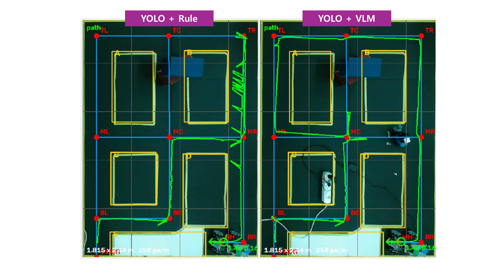

# 주행 결과와 지표

## 1. 통합 주행 · 2026-10-09

축소 항만 테스트베드에서 관제 화면으로 `START → TR → WH` 임무를 시작했습니다. 작업 구역, 경로 안팎의 컨테이너, 횡단 작업자를 배치한 동일 미션을 두 차례 연속 수행했습니다.

| 지표 | 기록 |
| --- | --- |
| 주행 1 | 155초 · 완주 · 수동 개입 0회 |
| 주행 2 | 151초 · 완주 · 수동 개입 0회 |
| VLM 호출 | 두 주행 합계 17회 |
| VLM 응답시간 | 평균 5.6초 · 최대 6.5초 |
| VLM 호출 실패 | 0회 |

| 시나리오 | 관측한 동작 |
| --- | --- |
| 작업 구역 | 해당 구간 차단 후 우회 |
| 경로 위 컨테이너 | 장애물 위치를 반영해 대체 경로 생성 |
| 경로 밖 컨테이너 | 기존 경로 유지 |
| 작업자 횡단 | 정지·대기 후 기존 경로로 재출발 |

## 2. 경로 선택 비교 · 2026-09-27

동일한 배치에서 감지 즉시 우회하는 `yolo_only`(T=0)와 VLM 기반 대응을 각각 주행하고 궤적을 기록했습니다.

*왼쪽은 감지 즉시 우회(T=0), 오른쪽은 VLM 기반 대응의 기록 궤적입니다.*

| 지표 | 감지 즉시 우회 | VLM 기반 대응 |
| --- | ---: | ---: |
| 궤적 기반 주행 거리 | 10.15 m | 8.45 m |
| 전체 소요시간 | 225초 | 227초 |
| 횡단 대응 | 해당 간선 차단 후 우회 | 대기 후 기존 경로 재개 |

VLM 방식은 이 사례에서 1.70 m 짧은 경로를 주행했습니다. 상황 판단과 대기에 사용한 시간이 있어 전체 소요시간은 2초 길었습니다.

## 3. 지표 정의

| 지표 | 집계 기준 |
| --- | --- |
| 통합 주행시간 | 10월 9일 각 미션의 시작부터 목적지 도착까지 |
| 수동 개입 | 두 통합 주행 중 운영자 개입 횟수 |
| 주행 거리 | 9월 27일 비교 주행의 기록 궤적 |
| 통합 주행 VLM 응답 | 두 주행의 호출 17회에 대한 응답 기록 |
| 후속 모델 응답시간 | 40개 저장 장면에 대한 별도 모델 평가 |

## 4. 후속 연구

모델 비교는 장면별 4프레임을 입력해 유효 응답 수, 호출 지연, Bedrock 참조 행동과의 일치율을 집계했습니다. 프롬프트 보완과 시간 규칙 민감도 분석은 별도 실험으로 정리했습니다.

[모델·프롬프트 평가](../research/README.md) · [모델 비교 CSV](../research/results/model_comparison.csv) · [시간 규칙 계산](../research/experiments/threshold_analysis.py)

## 검증 범위

| 구분 | 확인한 내용 | 근거 |
| --- | --- | --- |
| 실기체 통합 주행 | 횡단 대기·재출발, 작업 구역·경로상 장애물 우회, 경로 밖 장애물 통과 | 2026-10-09 연속 2회 기록 |
| 위치 보정·관제 시작 | 노트북 BEV 관측과 Jetson 보정 연결, 관제 미션 시작 | 실기체 개발·주행 기록 |
| 승인·오류 처리 | 승인·거부·요청 ID 대조, 운영자 정지·해제, 재출발 거부 시 정지 유지 | 원본 ROS 단위 검증 및 격리 ROS 시뮬레이션 |
| 공개 Python 예제 | 상태 진행 동결, 잘못된 응답 처리, 승인 ID, 모의 이벤트에서 대체 경로 계산까지 | 하드웨어 없는 16개 테스트 |
| 후속 연구 | 40개 저장 장면의 모델 비교, 프롬프트 보완, 시간 규칙 민감도 | 대회 시연 이후 별도 평가 |

선정지는 위험 트리거를 받은 Supervisor가 정지 상태를 발행하고, 웨이포인트 제어기가 속도 명령을 0으로 만드는 ROS 소프트웨어 경로입니다. VLM 응답 대기와 분리해 처리합니다.

[메인 README](../README.md)
